# Commonly used intelligent optimization algorithm improvement strategies - mutation section (five mutation strategies) can be applied to improve all intelligent algorithms, making even beginners capable of enhancing intelligent algorithms.

This article will discuss the common intelligent optimization algorithm improvement strategies - mutation section, which includes five commonly used mutation strategies:
Gaussian variation, t-distribution perturbation variation, adaptive t-distribution perturbation variation, Cauchy variation, differential variation.
Five strategies can be easily adapted to other intelligent algorithm improvements!
To facilitate a deeper understanding of the mutation strategies, the author will guide the readers through the particle swarm algorithm to apply these five strategies. This approach will also be beneficial for future integration into other intelligent algorithms.
Gaussian Variation:
The Gaussian function is as follows:
\n        \n  
Introduce the Particle Swarm Algorithm as follows:
\n        \n  
T-distribution disturbance variation:
\n        \n  
Introduce the Particle Swarm Algorithm as follows:
\n        \n  
Adaptive t-distribution perturbation;
Adaptive changes to C_Iter can be used in the early stages of the algorithm for global search, and in the later stages for local search, thereby achieving convergence.
freen = exp(4.*(l/iter).^2);  
Then, put it into this formula:
\n        \n  
Cauchy Variation:
The Cauchy probability density function is as follows:
\n        \n  
Incorporating Particle Swarm Algorithm:
xnewbest=xbest+xbest×Cauchy(0,1)  
Random differential mutation:
\n        \n  
Xα is the global optimal particle, X'(t) is a random particle, and r is a [0,1] random number.
Results display
The CEC2005 function set is demonstrated, with 1000 iterations and a population size of 100.
1. Particle Swarm Optimization (PSO)
2. Gaussian Variation Particle Swarm Optimization (GPSO)
3. t-Distribution Variation Particle Swarm Optimization (t-PSO)
4. Self-Adaptation t-Distribution Variation Particle Swarm Optimization (self_adaption_t_PSO)
5. Cauchy Variation Particle Swarm Optimization (CPSO)
6. Differential Evolution Particle Swarm Optimization (DE-PSO)

## Images

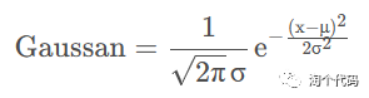
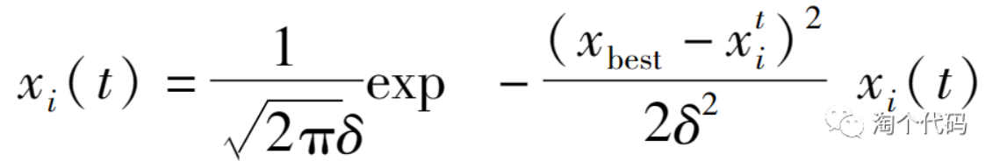
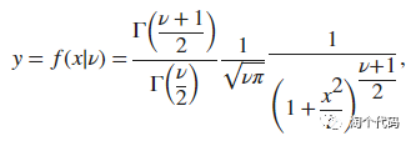

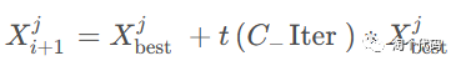
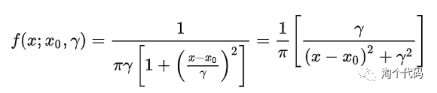
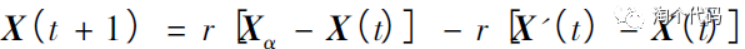
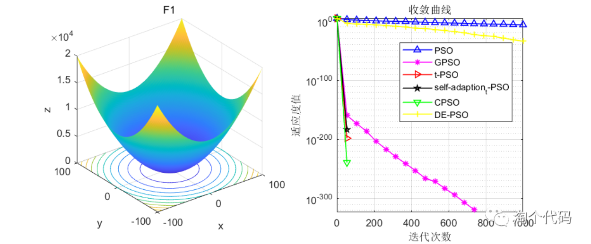
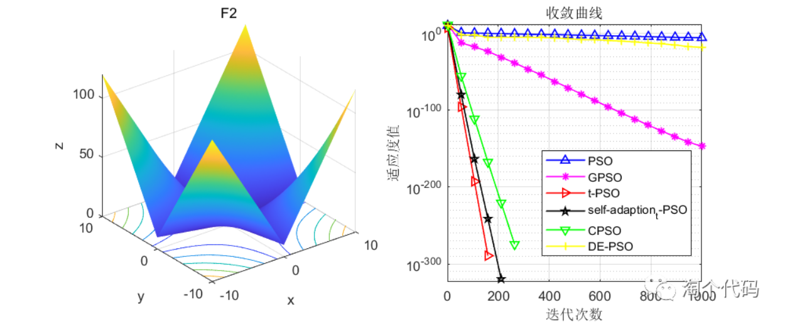
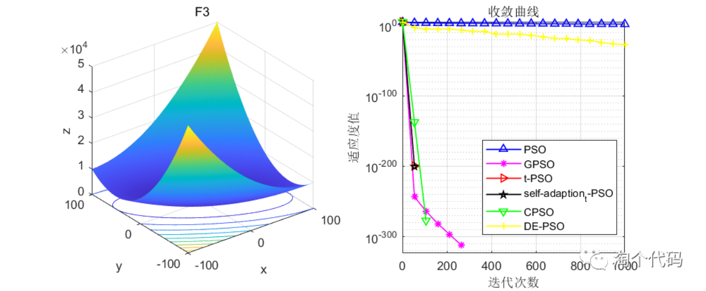
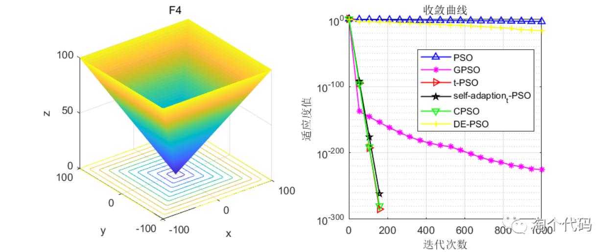
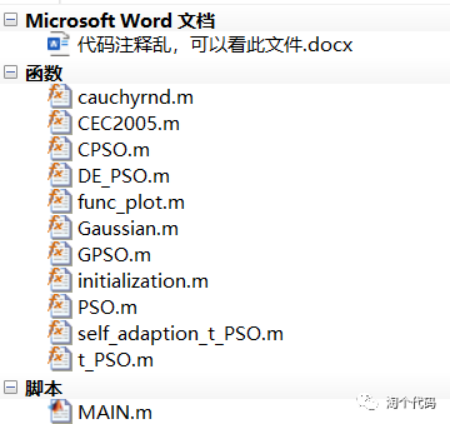

<!-- PAYMENT_BLOCK -->

## Get this dataset

- Payment link (Stripe): [Buy now](https://buy.stripe.com/3cs8yP7sY87d0vu9AB)
- Payment QR code: 

<!-- /PAYMENT_BLOCK -->
